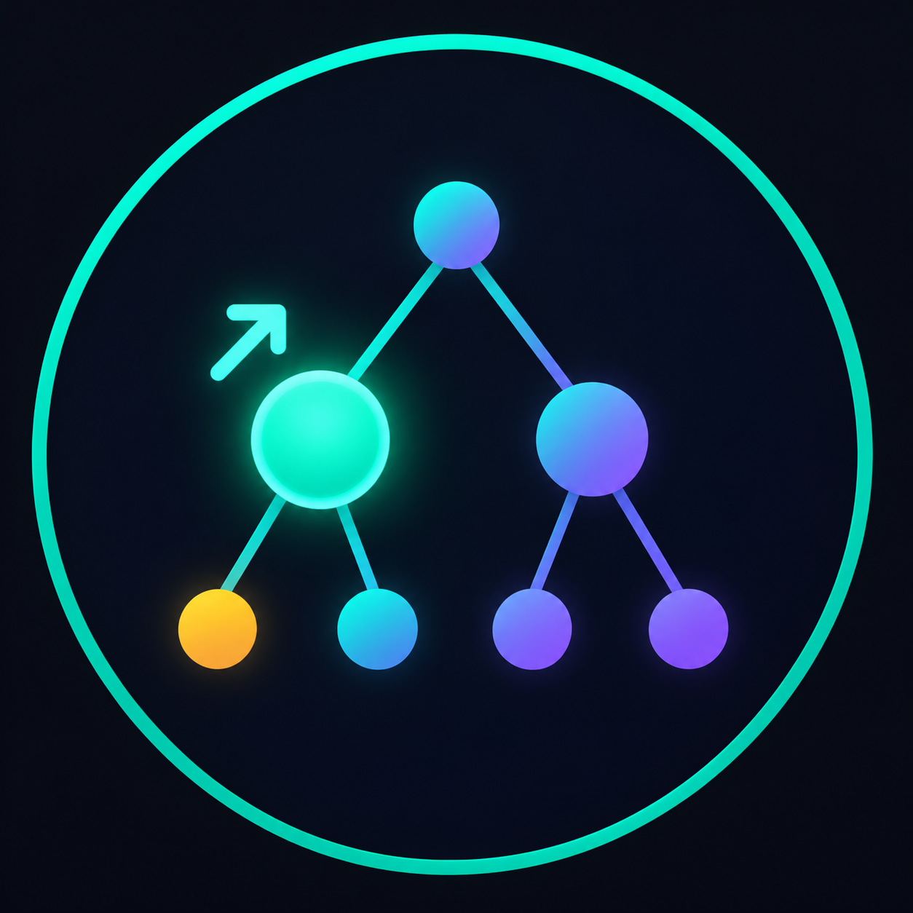

<p align="center"></p>

# QuestLineage

*by OzgurX* · Quest chain trees, a quest arrow and travel help for **World of Warcraft: Forever**
(client 1.60.1, Interface 16001).

Pick any quest and QuestLineage draws its whole lineage as a family tree, from the first quests at
the top down to the last: the quests that must come before it, the breadcrumbs that lead to it, the
follow-ups it opens and the quests that taking it closes for good. Each card shows the quest's state
for your character.

## Requirements

- **QuestieDB** (required): all quest data is read through QuestieDB's public API. QuestieDB's
  files are never changed.
- **WoWTR** (optional): when it is loaded, a Turkish option appears; quest titles, objectives and
  the interface are then in Turkish.

## Features

| Place | What you get |
|---|---|
| Main window (`/ql`) | Tabs on the left: **Quests** (what you can do now, most XP first), **Chains** (chains of your zone, in progress first), **Class** (your class quests), **Zones** (every zone with quests for you, by continent and level band, with the zone's map and quest pins) and **Search** (quests and creatures, as you type). Filters and XP · Level · Near sorting. Picking a quest opens its family tree and a detail panel: the quest giver in 3D, objective, **how to get there**, story, tasks with portraits and item icons, rewards and the quests before and after it. |
| Getting there | When a quest is in another zone or on another continent, the quickest way as a timeline: ride, flight paths you know, zeppelins, boats, the Deeprun Tram (by faction) and your hearthstone. Click a step and the arrow points there. |
| Arrow | Turns toward the quest giver, the nearest creature or object you still need, or where to hand the quest in, with the distance. On a long trip it leads you to the flight master or dock first. Colour, size and glow are settings. |
| Routes | Tick quests and build a route: nearest first, re-planned as quests move on. Draw your own routes and detours on the world map (Shift+click). |
| Maps | The route on the world map and minimap, objective areas of your quests, quest pins of a zone, the way back to your corpse. |
| Current quest window | The quest you are doing with live objective counters and bars, the way there, and every other quest in your log with filters. Can replace the game's quest tracker. |
| Quest card | QuestLineage's own window when an NPC offers or takes a quest: chain, warnings, objectives, rewards, voice-over (with WoWTR). |
| Quest actions | A small panel for the current quest: item buttons for what it has you use and the creatures it still needs (click to target); both can be bound to keys. |
| Quest items | Item tooltips name the quests that need the item, with your count; bag slots holding quest items get a mark. |
| Nameplates | A quest badge and counter beside every creature an unfinished objective needs (droppers included). |
| "Where?" bar | Repair, inn, flight master, trainers, food, mail and more: one click points the arrow at the nearest. |
| Hints | A note when another quest of yours is right here, and the next quest offered when you hand one in. |

## Commands

```
/ql                 open or close the window   (also /lineage, /questlineage)
/ql <id|name>       show the chain of a quest
/ql find <name>     where a creature stands, on the map
/ql arrow [id]      arrow status, or point it at a quest
/ql travel [id]     how to get to a quest in another zone
/ql lang en|tr      interface language (tr needs WoWTR)
/ql here            where you stand (map and coordinates)
/ql options         settings
/ql status          database and language status
/ql errors          errors caught so far
```

## Install

Put the `QuestLineage` folder in `World of Warcraft\_forever_\Interface\AddOns\` next to QuestieDB
and restart the game.

## Türkçe

QuestLineage bir görevin tüm zincirini (ön koşullar, yönlendirme görevleri, takip görevleri ve
alınca kalıcı olarak kapanan görevler) ağaç olarak gösterir; yön oku, rotalar, başka bölgedeki
görevler için yol tarifi (uçuş, zeplin, gemi, tram, hearthstone) ve güncel görev penceresi
içerir. Arayüz İngilizcedir; **WoWTR** kuruluysa ayarlardan (`/ql options` veya `/ql lang tr`)
Türkçe seçilebilir.

## Development

No build step. Tests run in plain Lua 5.1 without the game: `python tests/run.py` (needs
`pip install lupa`). `python tools/package.py` builds the release zip in `dist/`.

## License

MIT (see `LICENSE`). The Inter font in `Media/Fonts` is by The Inter Project Authors under the SIL
Open Font License 1.1 (`Media/Fonts/Inter-OFL.txt`). Quest data comes from the QuestieDB addon at
run time and is not bundled.
